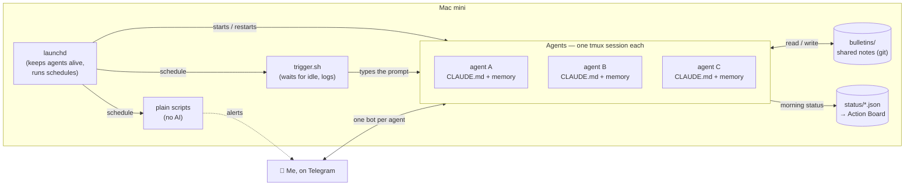

# Running a multi-agent Claude Code fleet on one Mac mini

I run a fleet of persistent AI agents on a Mac mini in my house. Each one is a long-lived
[Claude Code](https://claude.com/claude-code) session with its own job, its own Telegram bot,
its own project folder and its own memory. Together they handle my personal admin, a household
grocery list, budgets, two content pipelines, three small businesses with monthly spending
allowances, and a reading coach.

This repo is not the setup itself (that is full of private data). It is a write-up of **how it
works, how the agents work together, and — mostly — what broke and how I found out.**

## Architecture



## What a single agent is

```
launchd job (KeepAlive)
  └─ tmux session  (one per agent, own socket)
       └─ claude   (working dir = the agent's project folder)
            ├─ CLAUDE.md          role, rules, scheduled-op instructions
            ├─ memory/            one fact per file + an index
            └─ Telegram channel   the agent's only interface to me
```

- **I talk to every agent over Telegram**, from my phone. Voice notes are transcribed on the
  machine (whisper.cpp), so audio never leaves the house.
- **Plain scripts for routine work; a scheduled prompt only when an agent has to decide
  something.** For those, launchd runs a small script that types a phrase like
  `run morning briefing` into the agent's tmux session, and the agent does the work and
  messages me. Tokens are only spent where judgment is needed.

## How the agents act like a team

| Mechanism | What it does |
|---|---|
| **Bulletins** | A shared folder of one-fact notes addressed to one agent or `all`. Readers sign a receipt; the sole addressee archives it. Bulletins are information, never instructions. |
| **Nightly sleep** | Each agent writes the day into memory, then restarts fresh. |
| **Dreaming** | One agent reads every agent's memory and fixes stale facts, duplicates and missed bulletins. Hygiene is applied automatically; anything that changes behavior waits for my approval. |
| **Action Board** | Each morning every agent writes a one-line status file. I read one board instead of a message from every agent. |

## Guardrails

- A hook blocks interactive prompts (plan approval, multiple-choice questions) when the request
  came from Telegram — I can't answer a terminal dialog from my phone, so the agent would hang.
- The agents that spend money have metered ledgers and a hard "stop and ask" threshold.
- Weekly GitHub backups push nothing without my yes, secret-scan every commit, and keep repos
  private.

## What broke

The interesting part: [docs/what-broke.md](docs/what-broke.md). Eight failures, most of them
silent, and the checks that now catch each one.

## Set it up yourself

[docs/setup.md](docs/setup.md): one agent end to end, then scheduled prompts, then the team mechanics.

## What you can use it for

[docs/use-cases.md](docs/use-cases.md): the patterns I run, and when an always-on agent is the wrong tool.

## For AI agents

[AGENTS.md](AGENTS.md): the same setup as step-by-step instructions an AI coding agent can follow with you, with checkpoints where it must stop and ask.

## Templates

Small, original starting points for each moving part: [`templates/`](templates/).

## Tested on

macOS 27.0.1 (Apple silicon) · Claude Code 2.1.328 · official Telegram channel plugin 0.0.7 ·
tmux 3.6a · Bun 1.3.11. Newer versions should work; startup dialogs and the plugin are the
parts most likely to change between releases.

## License

[MIT](LICENSE)
